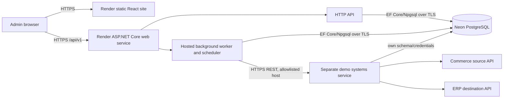

# Architecture

Implementation note (Phase 6): the combined process queues manual and scheduled runs, checkpoints pages, stores outcomes and attempts, schedules retries, supports cancellation and recovery, and fences stale worker writes. The React dashboard uses the authenticated API and polls live run state. The Render Blueprint preserves this combined process choice; see the [deployment runbook](phase6-deployment.md) for release order, secrets, and limitations.

Status: Phase 0 baseline, 2026-10-26. See [ADR 0001](adr/0001-modular-monolith.md) for the process decision.

## Components and trust boundaries



The diagram shows logical modules inside one hub process. The demo systems are a separate HTTP application, even when they share a Neon project. They use separate database credentials and schema; the hub has no direct access to simulator tables. The destination enforces its own uniqueness constraint. Only the hub API and approved simulator endpoints are public. Simulator fault controls require administrator authentication.

## Deployment choices

- Build one .NET 10 hub image. ASP.NET Core hosts controllers or minimal API routes and a `BackgroundService` for scheduling and sync execution. A single Render web service starts both through one process.
- Build the React/TypeScript UI as a Render static site. The UI calls the versioned hub API over HTTPS; CORS permits only the configured UI origin.
- Run the hub on a free Render web instance for this public demo. Render sleeps it after inactivity, pausing scheduled polling and pending retries until an incoming request wakes the service. The persisted run state and lease support continuation after restart, but unattended schedules are not time-guaranteed on the free tier.
- Deploy the demo systems as one separate Render web service with distinct `/commerce` and `/erp` HTTP contracts. Local Docker Compose starts it as a separate service.
- Use Neon PostgreSQL Free for hosted durable state. Use local PostgreSQL under Compose. Keep hub and demo data in separate schemas and roles. Use TLS, bounded Npgsql pools, and reconnect after transient database disruption. While the hub is awake, poll due schedules about once per minute and eligible work more frequently while a run is active. This periodic polling may keep Neon compute active, so monitor the Free plan allowance.
- Apply EF Core migrations in a controlled deployment step using a direct Neon connection and a migration role. The hub process does not auto-migrate on startup. Roll out backward-compatible schema changes before the application version that needs them.
- Store all durable work in PostgreSQL. Render instance files hold no run or record state.

Render starts a replacement instance while the old one remains live during deployment. The database claim, lease, and fencing rules below therefore apply even if the service is configured for one normal replica. Render sends `SIGTERM` to the old instance; the host's cancellation token stops new claims and page fetches, then current operations either commit or are recovered after lease expiry. A readiness endpoint checks that the schema version is compatible and a database operation succeeds. Liveness reports process health without depending on Neon availability.

## Module boundaries

| Module | Owns | Depends on |
| --- | --- | --- |
| Domain | Run and record state transitions, identity, retry policies | No framework or transport types |
| Application | Configuration validation, run creation, orchestration, counters | Domain and connector contracts |
| Connector contracts | Source pages, destination writes, capabilities, normalized errors | Domain value types |
| REST adapters | HTTP auth, pagination, serialization, timeouts, error translation | Connector contracts |
| Infrastructure | EF Core, migrations, leases, secret storage | Application interfaces |
| API | Auth, input validation, HTTP contracts, health checks | Application |
| Worker | Polling, atomic claims, execution, lease renewal, recovery | Application and infrastructure |
| Demo systems | Synthetic source, destination, fault injection | Its own data access only |
| Frontend | Admin workflows and safe status display | Public API contracts |

The hub is a modular monolith. Projects may be combined or split within the solution as dependency boundaries require, but there is one deployable hub process. Connector adapters cannot make persistence or scheduling decisions; the domain cannot call HTTP or EF Core.

## Connector and mapping contract

The MVP supports the `restOrdersV1` connector kind. Source capabilities are stable cursor pagination and snapshot tokens. Destination capabilities are idempotent upsert and lookup by stable external identity. A connector configuration contains a server-validated base URL, role, authentication mode, timeout, and page size. Hosted URLs are selected from an administrator-controlled allowlist; DNS resolution and redirects are checked so a public user cannot reach loopback, private, or metadata addresses. Secrets are stored encrypted using a deployment secret and represented by a `secretSet` flag in API responses.

Mapping configuration is JSONB with `schemaVersion: 1`, a fixed field-path grammar, unique destination fields, and only `trim`, `decimal`, and `utcDate` transforms. Required-field and type rules are declared, not executable code. Configuration is validated before enablement and snapshotted on each run. A retry of the same run uses that immutable snapshot. An administrator starts a new run to use edited configuration.

## Run and recovery flow

1. An authorized API request validates the enabled integration and commits a `queued` run with its configuration snapshot. A PostgreSQL partial unique index rejects a second active run for the integration. The API returns `202` only after commit.
2. The worker atomically claims a queued or expired run, assigns a lease owner and increments a fencing generation. Each later worker write locks the run row, checks the owner, generation, status, and expiry, then commits its checkpoint or outcome in that same transaction. Lease renewal is conditional on the same ownership fields.
3. The source returns a page with a snapshot token, request cursor, next cursor, and stable source IDs. The worker writes the page and all record work items in one transaction before advancing the run checkpoint. If it crashes before this commit, it refetches the same page. A duplicate source ID within a source snapshot is treated as a source contract error, never silently counted twice.
4. The worker maps and validates each persisted record. Invalid data becomes a terminal record failure. Before a valid record is sent, a `started` attempt commits. The write uses the stable key `integrationId:sourceRecordId` and a source version or canonical payload hash. The demo ERP enforces `(integration_id, source_record_id)` uniqueness and returns `created`, `updated`, or `unchanged`. Recovery marks an unfinished attempt `uncertain` before replay.
5. An uncertain response, timeout, 429, or 5xx error records an attempt and `nextAttemptAtUtc`. The worker releases its lease until the persisted retry time, then claims eligible work later, up to the configured budget. `Retry-After` is considered within the configured maximum delay and run deadline.
6. Once all source pages and eligible record work are settled, the worker derives counters from final record states and transitions the run to `completed` or `completed_with_errors`. A source-wide failure or exhausted infrastructure retry budget makes the run `failed` while preserving completed records and the checkpoint.
7. On graceful shutdown the worker releases an active lease for prompt continuation. On startup and during polling, a worker reclaims runs with expired leases. It increments the fencing generation, resumes persisted records first, then refetches the next uncommitted page. An old worker's late database update fails its generation check. Repeated destination HTTP writes use the same identity and are safe after a lost response.

Manual `POST /runs/{id}/retry` applies to a `failed` run caused by a retryable source, destination, or infrastructure error. It requeues that same run, increments a recovery generation, and gives failed transient records a new bounded attempt budget. Successful and permanent-data records remain settled. It continues from the durable page checkpoint using the original source snapshot and config. If no page was fetched, the source establishes a snapshot on its first successful response. Every recovery action is in `sync_run_event`. `completed_with_errors` from permanent data errors needs a corrected source/configuration and a new manual run. The simulator retains snapshot tokens long enough for the demo; a real connector lacking stable snapshots would need a documented rescan and reconciliation policy.

## Scheduling and concurrency

Schedules use UTC intervals with a minimum interval of five minutes. The worker polls due schedules and requests runs in a transaction. `next_run_at_utc` is advanced exactly once when a due occurrence is handled. If an active run exists, a `schedule_event` records a skipped occurrence; it is not queued behind an unbounded backlog. Manual requests return `409` on overlap. Only one worker can claim a run at a time; short transactions and a lease renewal interval shorter than the lease duration make takeover observable. A worker pauses new external writes when it cannot renew its lease or reach Neon.

## Errors, observability, and security

Adapters normalize errors as `transient`, `rateLimited`, `permanentData`, `permanentConfiguration`, `authentication`, `concurrencyConflict`, `infrastructure`, or `cancelled`. HTTP status alone does not determine the category. APIs use RFC 9457 Problem Details for request failures and stable error codes for record failures. Logs include run ID, record ID, connector ID, attempt, and trace ID; they exclude secret values and raw payloads. Metrics cover run duration, records, retries, failures, and expired-lease recovery.

Admin routes require a signed bearer token obtained with a password at `/api/v1/auth/login`; the local password is development-only. Hosted configuration requires a PBKDF2 password hash and separate token signing key. The browser keeps its token in memory. Demo fault injection and reset endpoints require an admin key; the development-only hub fault proxy exposes bounded source 503 injection to authenticated dashboard users. Database URLs, encryption keys, and API keys will be Render environment secrets. Use separate low-privilege Neon roles for hub runtime, migrations, and simulator. Connector hostnames are allowlisted, redirects are disabled, and hosted DNS connections reject private and loopback addresses.

## Planned repository and startup

```text
src/IntegrationHub.Api          ASP.NET Core host and HTTP contracts
src/IntegrationHub.Domain       policies and state machines
src/IntegrationHub.Application  use cases and orchestration
src/IntegrationHub.Infrastructure EF Core and secret protection
src/IntegrationHub.Connectors.Rest HTTP adapters
src/IntegrationHub.DemoSystems  separate HTTP simulator host
frontend/admin-dashboard        React/TypeScript UI
tests/                         unit and PostgreSQL/HTTP integration tests
deploy/                        Docker and Render definitions
docs/                          specifications and ADRs
```

`docker compose up --build` starts PostgreSQL, hub, simulator, and dashboard. A dedicated migration command applies schema changes, and development-only seed commands load deterministic synthetic orders. The reset command requires a demo-only guard and never runs automatically at application startup. CI builds, tests, and verifies migrations from an empty database.

## Hosting references

- [Render free web service behavior](https://render.com/docs/free) and [deployment overlap and shutdown](https://render.com/docs/deploys).
- [Neon compute lifecycle and connection guidance](https://neon.com/docs/manage/endpoints/).
- [.NET release and support policy](https://learn.microsoft.com/dotnet/core/releases-and-support).
