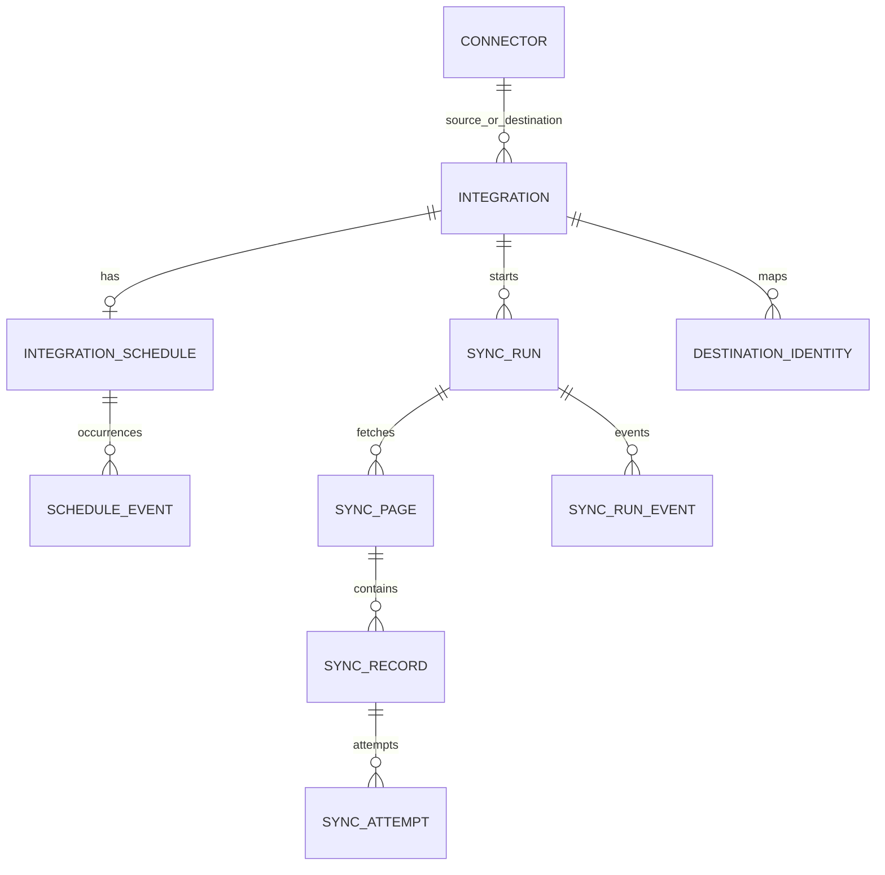
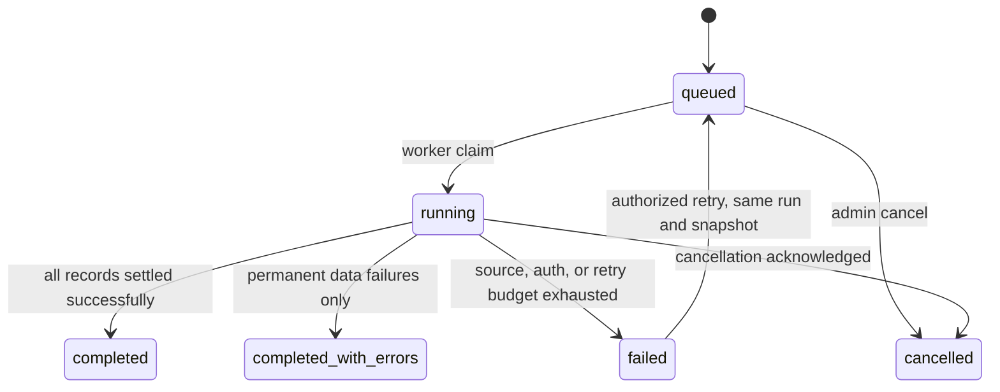
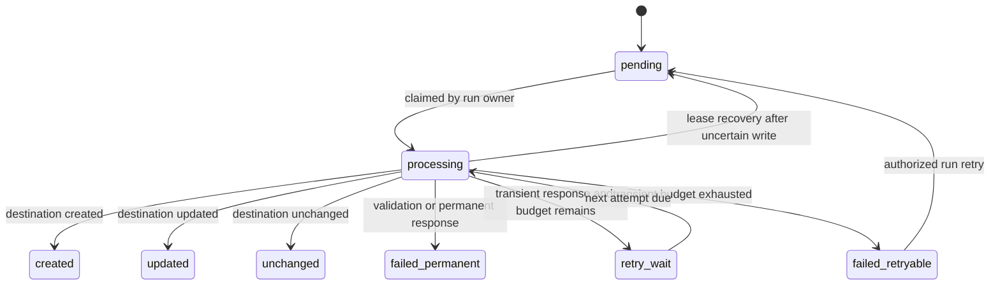

# Data model and state machines

Status: Phase 0 logical schema, annotated for the Phase 4 implementation. The EF Core migrations define the physical column names and constraints. All timestamps are `timestamptz` in UTC and all IDs are UUIDs.

## Entity relationships

## Hub tables

| Table | Important columns | Constraints and indexes |
| --- | --- | --- |
| `connector` | `id`, `name`, `kind`, `role`, `config_jsonb`, `encrypted_secret`, `enabled`, `created_at_utc`, `updated_at_utc`, `row_version` | `kind = restOrdersV1` initially; role source/destination; no secret in config JSON; index by role and enabled. |
| `integration` | `id`, `name`, `source_connector_id`, `destination_connector_id`, `entity_type`, `mapping_jsonb`, `validation_jsonb`, `retry_policy_jsonb`, `enabled`, `row_version` | Two connector FKs; source and destination must have correct roles; `entity_type = orders`; mapping schema validated in application. |
| `integration_schedule` | `id`, `integration_id`, `interval_seconds`, `next_run_at_utc`, `last_handled_at_utc`, `enabled`, `row_version` | Unique `integration_id`; minimum 300 seconds; index `(next_run_at_utc)` where enabled. |
| `schedule_event` | `id`, `schedule_id`, `due_at_utc`, `outcome`, `run_id`, `occurred_at_utc` | Unique `(schedule_id, due_at_utc)`; records created or overlap-skipped occurrences. `run_id` nullable for skips. |
| `sync_run` | `id`, `integration_id`, `status`, `trigger_type`, `config_snapshot_jsonb`, `source_snapshot_token`, `next_page_cursor`, `source_complete`, `source_attempt_count`, `next_source_attempt_at_utc`, `lease_owner`, `lease_generation`, `lease_expires_at_utc`, `recovery_generation`, `cancellation_requested_at_utc`, `created_at_utc`, `started_at_utc`, `finished_at_utc`, `deadline_at_utc`, `last_error_code`, `last_error_category` | Partial unique index on `(integration_id)` where status in (`queued`, `running`); index queued runs by creation and running runs by lease expiry; immutable config snapshot after creation. |
| `sync_page` | `id`, `run_id`, `request_cursor`, `next_cursor`, `page_number`, `record_count`, `persisted_at_utc` | Unique `(run_id, page_number)`; one transactional insert with its records. Cursors are bounded opaque strings. |
| `sync_record` | `id`, `run_id`, `page_id`, `source_record_id`, `source_payload_jsonb`, `source_version_hash`, `idempotency_key`, `status`, `attempt_count`, `next_attempt_at_utc`, `destination_record_id`, `error_category`, `error_code`, `safe_error_message`, `finished_at_utc` | Unique `(run_id, source_record_id)` and `(run_id, idempotency_key)`; index eligible work by `(run_id, status, next_attempt_at_utc)`; payload is synthetic, size-limited, and access-controlled. |
| `sync_attempt` | `id`, `record_id`, `attempt_number`, `recovery_generation`, `started_at_utc`, `finished_at_utc`, `outcome`, `http_status`, `error_category`, `error_code`, `duration_ms` | Unique `(record_id, attempt_number)`; append-only history. Attempt numbers never reset when a run is retried. |
| `sync_run_event` | `id`, `run_id`, `event_type`, `occurred_at_utc`, `actor_type`, `safe_details_jsonb` | Append-only audit of claim, lease loss, source-page failure, retry, cancellation, schedule skip, and terminal transition. No secrets or raw HTTP body. |
| `destination_identity` | `id`, `integration_id`, `source_record_id`, `destination_record_id`, `last_source_hash`, `last_synced_at_utc` | Unique `(integration_id, source_record_id)`; convenience lookup in the hub, not the only duplicate defense. |

The simulator owns separate `demo` schema tables for immutable source snapshots and ERP orders. Its ERP order table has a unique `(integration_id, source_record_id)` constraint and stores the last source hash. The local Compose setup uses one development database role for both schemas; separate restricted roles are a hosted deployment requirement. A repeated key with the same hash returns `unchanged`; a new hash updates the same order and returns `updated`. This destination behavior is the decisive idempotency guarantee after a lost response.

Connector configuration JSON has a schema version and non-secret fields only: `baseUrl`, `authMode`, `pageSize`, and `timeoutSeconds`. A run's `config_snapshot_jsonb` includes connector settings, encrypted credentials, mapping, validation, and retry policy. A retry of that run therefore uses exactly the original configuration, including credentials; credential rotation affects newly created runs. The encryption key must remain stable across restart and recovery.

`source_payload_jsonb` is needed to resume record work without refetching a committed page. It is limited to synthetic records in the MVP. For real customer data, this column requires an explicit retention, encryption, and access policy before use.

## Atomic persistence rules

1. Run creation and the one-active-run check occur in one transaction. The partial unique index is the final concurrency guard, including manual versus scheduled races.
2. Claiming or reclaiming a run changes `lease_owner`, increments `lease_generation`, and sets `lease_expires_at_utc` in one transaction. Every worker state mutation checks the generation and owner.
3. A fetched page, its record work items, the run's next cursor, and source-complete flag commit together. The page's snapshot token must match the run's token. A fetch lost before commit is safe to repeat; a duplicate source ID is a source contract failure.
4. Before an outbound write, `processing` and a `started` attempt entry commit together. On a response, the attempt outcome and record state commit together. If the process dies between those transactions, recovery marks the open attempt `uncertain` and creates a new attempt with the same destination identity. A destination write and a PostgreSQL transaction cannot commit atomically; replay uses the stable destination identity.
5. Final run counters are calculated from record states, not incremented blindly after each HTTP attempt. `fetched` is the number of distinct persisted source records. The API's aggregate `pending` includes `pending`, `processing`, and `retry_wait` records; `created + updated + unchanged + failedPermanent + failedRetryable + pending` always equals `fetched`. The run is final only when `pending = 0` and source pagination is complete, or it is explicitly `failed`/`cancelled` with unfinished work shown.
6. A schedule occurrence is claimed and `next_run_at_utc` advanced transactionally with run creation or a `schedule_event` recording an overlap skip. It cannot create two runs for the same occurrence.

## Run state machine

An expired lease does **not** change the run status from `running`; a new worker atomically takes ownership and increments the fencing generation. `completed`, `completed_with_errors`, and `cancelled` do not transition to `queued`. A failed run may be retried only when its last error is classified retryable and its overall recovery limit has not been reached. The retry clears `finished_at_utc`, preserves all attempts and successful records, changes `failed_retryable` records to `pending`, resets the per-recovery source retry budget, increments `recovery_generation`, and records an event. A new run is required after changing mapping or correcting permanent data.

## Record state machine

`processing` is recoverable after lease takeover. Its previous destination write may have committed, so the next attempt uses the same idempotency key. A `failed_permanent` record stays settled within that run. A new run can process corrected source data or configuration. `created`, `updated`, and `unchanged` never re-enter work on retry of the same run.

## Retry and error policy

Default per-record budget: four HTTP write attempts per recovery generation, two-second base exponential delay, 60-second cap, and bounded jitter. The implementation exposes these as validated configuration values with safe maxima. A valid `Retry-After` affects the delay up to the configured maximum; the one-hour run deadline still applies. Authentication and malformed connector responses stop the run; invalid record data fails only the affected record. Source-page failures use a separate bounded run-level retry counter and persisted next-attempt time; each failure is recorded in `sync_run_event`. No delay exists solely in process memory.

## Retention and migration rules

Keep run metadata and safe errors for the demo; set a retention window for synthetic record payload snapshots before public release. The reset command deletes only demo-scoped data after a guard checks the environment. Migrations must create the partial unique index and identity constraints before accepting run traffic. Each migration has a tested forward path from an empty database and a documented rollback implication.
